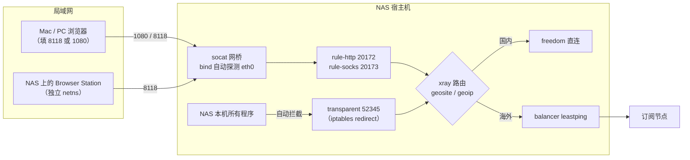

# QNAP NAS 透明代理全流程：v2rayA + 自动分流 + 局域网共享 + GitHub 加速

> 在一台 QNAP NAS（QTS 5.x / Container Station）上把 v2rayA 跑成**全屋网关级代理**：
> NAS 本机零配置自动分流，局域网设备填一个端口就能用，国内直连、海外走节点，
> 顺带把 GitHub 拉代码也修好。
>
> 全文基于**实测环境**写成，每个坑都标注了根因和验证命令，不是抄来的配置堆砌。

---

## 目录

- [能实现什么](#能实现什么)
- [架构](#架构)
- [快速开始 TL;DR](#快速开始-tldr)
- [0. 环境与前提](#0-环境与前提)
- [1. 创建目录](#1-创建目录)
- [2. 部署 v2rayA](#2-部署-v2raya)
- [3. 初始化面板 + 订阅 + 连接](#3-初始化面板--订阅--连接)
- [4. 流量分配（核心章节）](#4-流量分配核心章节)
- [5. 局域网共享](#5-局域网共享)
- [6. GitHub 加速](#6-github-加速)
- [7. 验证清单](#7-验证清单)
- [8. 排错手册](#8-排错手册)
- [9. 运维：备份 / 升级 / 回滚](#9-运维备份--升级--回滚)
- [10. 安全须知](#10-安全须知)
- [附录 A：端口总表](#附录-a端口总表)
- [附录 B：仓库文件清单](#附录-b仓库文件清单)

---

## 能实现什么

| 能力 | 效果 |
|---|---|
| NAS 本机 | 所有程序（下载器、Docker 里的 curl、Shell）**零配置**自动走代理，自动分流 |
| 局域网设备 | 填 `NAS_IP:8118`（HTTP）或 `NAS_IP:1080`（SOCKS5）即可，**端口本身自动分流** |
| 国内访问 | `geosite:cn` / `geoip:cn` 直连，不绕行，延迟与直连一致 |
| 海外访问 | 走你订阅的节点，节点间按 `leastping` 自动选最快 |
| GitHub | `git clone` / `curl` 不再玄学超时（FastGithub 本地加速 + 镜像加速拉镜像） |
| 抗折腾 | QTS 重启、防火墙重载、换 IP 都能自愈或自动适应 |

---

## 架构



**一句话原理**：NAS 本机流量被 `iptables` 重定向进 xray 的 `transparent` 入站；局域网设备进来的是标准代理协议，走 `rule-http` / `rule-socks` 入站。**只有 `rule-*` 和 `transparent` 入站吃分流规则**，其它入站全部落到兜底规则走全量——这是整套东西最容易搞错的地方。

---

## 快速开始 TL;DR

```bash
export D=/share/CACHEDEV1_DATA/.qpkg/container-station/bin/docker

# 1. 建目录
sudo mkdir -p /share/Container/v2raya/{config,logs}
sudo chown -R 1000:1000 /share/Container/v2raya

# 2. 放 compose，起容器
cd /share/Container/v2raya && $D compose up -d

# 3. 浏览器打开面板，建账号 → 导入订阅 → 更新 → 连接
#    http://<NAS_IP>:2017

# 4. 设置里：透明代理=白名单模式，SOCKS5(PAC)端口填 20173（别漏！）
# 5. 验证
./scripts/verify-split.sh <NAS_IP>
```

前 3 步不通，看[排错手册](#8-排错手册)；第 4 步是 90% 的人漏掉的地方，见 [4.2](#42-一个隐藏开关socks-分流端口默认是关的)。

---

## 0. 环境与前提

实测环境（你的版本不必完全一致，但大版本要接近）：

| 项目 | 版本 |
|---|---|
| NAS | QNAP，QTS **5.2.9**，内核 `5.10.60-qnap`，x86_64 |
| Container Station | Docker **27.1.2-qnap8** / Compose **v2.29.1-qnap2** |
| v2rayA | `mzz2017/v2raya:v2.5.10`（内置 core 基于 xray-core） |
| 前端 | 不需要额外组件，v2rayA 自带 Web 面板 `:2017` |

前提：

1. Container Station 已安装并在跑；
2. 你能 SSH 登录 NAS，且账号有 `sudo` 权限（改 iptables 必需）；
3. 你有一个**可用的订阅链接**（机场 / 自建都行，v2rayA 支持 v2ray/xray 系订阅）。

> QNAP 上 `docker` 命令不在默认 PATH。下文统一用这个位置，建议先记下来：
>
> ```bash
> export D=/share/CACHEDEV1_DATA/.qpkg/container-station/bin/docker
> $D ps
> ```

---

## 1. 创建目录

```bash
sudo mkdir -p /share/Container/v2raya/{config,logs}
sudo chown -R 1000:1000 /share/Container/v2raya
```

`config` 里会存放账号、节点、规则和生成的 `config.json`，**必须挂载出来**，否则容器一重建全部清零。

---

## 2. 部署 v2rayA

把本仓库的 [`docker-compose.yaml`](docker-compose.yaml) 放到 `/share/Container/v2raya/`，然后：

```bash
cd /share/Container/v2raya
$D compose up -d
$D ps --filter name=v2raya
```

三个容器都应该是 `Up`：

```
v2raya          Up (healthy)
v2raya-lan      Up
v2raya-markfix  Up
```

### 这份 compose 里每一行为什么必须这么写

| 配置 | 原因 |
|---|---|
| `network_mode: host` | 透明代理要直接改主机网络栈；不然 iptables 规则落在容器 netns 里，对宿主机无效 |
| `privileged: true` | 写 iptables、读 `/dev/net/tun` 需要特权 |
| `--nftables-support=off` | QNAP 内核**没有 `nf_tables` 子系统**。开着它 v2rayA 会走 nft 路径，直接失败 |
| `IPTABLES_MODE: legacy` | 镜像里的 `iptables` 是包装脚本，靠这个变量选后端。默认会走 `xtables-nft-multi`，QNAP 上必失败；**只有 legacy 能用** |
| `dns: 223.5.5.5` | 宿主机若装了 Tailscale，`/etc/resolv.conf` 会指向 MagicDNS `100.100.100.100`，解析订阅/节点域名经常超时 |
| `v2raya-markfix` 容器 | **最关键的一个补丁**，见下节 |
| `v2raya-lan` (socat) | v2rayA 生成的入站全部只监听 `127.0.0.1`，局域网连不上，必须转发 |

### 为什么需要 markfix（QTS 的一个固件级坑）

QTS 在 `mangle OUTPUT` 里有一条无条件规则：

```bash
-j CONNMARK --restore-mark --nfmask 0xffffffff --ctmask 0xffffffff
```

它用 conntrack mark（=0）**全掩码覆盖**每个本地出站包的 packet mark。而 xray 出站靠 `SO_MARK 0x80` 做「别再拦我」的标记，被抹掉之后 → v2rayA 的 `--mark 0x80 RETURN` 旁路永远匹配不上 → xray 自己的出站连接又被透明代理抓一次 → **无限自连**，一次请求能打出 80 多个自连，整机网络瘫痪。

修复办法是在 `mangle OUTPUT` 最前面插一条：

```bash
iptables -t mangle -I OUTPUT 1 -p tcp -m mark --mark 0x80/0x80 -j RETURN
```

已带 `0x80` 的包直接跳过本链（也就跳过了 restore），mark 才能存活。`markfix` 容器每 30 秒检查一次并补插（`-C` 判重，幂等），因为 QTS 升级/重启/防火墙重载都可能清掉它。

自检：

```bash
sudo iptables -t mangle -L OUTPUT -n -v | head -5
# 第一行应该是 RETURN ... mark match 0x80/0x80
```

---

## 3. 初始化面板 + 订阅 + 连接

### 3.1 建管理员账号

浏览器打开：

```
http://<NAS_IP>:2017
```

首次访问会让你创建管理员账号，**这个密码只存在 NAS 本地**，忘了只能删库重来，记好。

### 3.2 导入订阅

1. 左侧「导入」→ 选 **订阅链接**；
2. 填订阅 URL 和备注名 → 确定；
3. 到「订阅」列表，点刚建的那条 → 右上「**更新**」，它会拉取节点；
4. 拉完后在「服务器」页能看到节点（通常带分组/国家标记）。

> 订阅里如果带 `vmess://`、`vless://` 之类的单节点链接，也可以用「导入 → 节点」一条条贴。

### 3.3 连接

「服务器」页勾选节点（或整组）→ 右上「**连接**」。v2rayA 会用 `leastping` 策略在这几个节点里挑最快的，之后按分钟级重测自动切换。

连接成功后，`config.json` 会被生成到 `/share/Container/v2raya/config/config.json`。

### 3.4 打开透明代理

「设置」页（不同版本措辞略有差异，认关键词）：

| 设置项 | 取值 | 说明 |
|---|---|---|
| 透明代理 / 系统代理 | **透明代理**，模式选 **白名单模式（whitelist）** | 国内直连、其余走代理 |
| 透明代理类型 | `redirect` | QNAP 上 `tproxy` 需要额外内核模块，redirect 更稳 |
| 端口：SOCKS5 | `20170` | 全量 |
| 端口：HTTP | `20171` | 全量 |
| 端口：HTTP（PAC / 分流） | `20172` | **按规则分流** |
| 端口：SOCKS5（PAC / 分流） | `20173` | **按规则分流**，默认是 0（关闭），必须手动填 |
| DNS 劫持 | 关 | 家用环境宿主机 DNS 本来就干净，开了反而多一层风险 |
| 排除接口 | `docker*,veth*,wg*,ppp*,br-*` | 保持默认，避免容器流量进代理后成环 |

> ⚠️ 每次「保存」都会重启 core，NAS 会有几秒钟断网，属正常。

---

## 4. 流量分配（核心章节）

### 4.1 三条通道

| 通道 | 入口 | 谁在用 | 分流 |
|---|---|---|---|
| 透明代理 | `iptables` 重定向 → `127.0.0.1:52345` | NAS 本机所有程序 | ✅ 按规则 |
| 分流端口 | `20172`(HTTP) / `20173`(SOCKS) | 局域网设备、NAS 上的浏览器 | ✅ 按规则 |
| 全量端口 | `20171`(HTTP) / `20170`(SOCKS) | 特殊场景（需要整体出境） | ❌ 全部走节点 |

**为什么 20171 全量而 20172 分流？** 因为 v2rayA 生成路由规则时会写死 `inboundTag`：

```json
{"inboundTag": ["rule-http_ipv4", "rule-socks_ipv4"], "domain": ["geosite:cn"], "outboundTag": "direct"}
{"inboundTag": ["transparent"], "domain": ["geosite:cn"], "outboundTag": "direct"}
{"balancerTag": "proxy", "port": "0-65535"}   // 兜底：全量
```

`socks_ipv4` / `http_ipv4` 这两个 tag 不在任何一条规则里，所以它们的流量直接命中最后那条兜底规则 → 全量出境。**这就是"明明有分流规则，国内网站却慢成狗"的根因。**

### 4.2 一个隐藏开关：SOCKS 分流端口默认是关的

模板里的 `rule-socks` 是**占位符**。只有对应的 PAC 入站存在时，才会被替换成真实 tag `rule-socks_ipv4`；而当 `socks5WithPac = 0` 时占位符原样保留 → 这条规则永远匹配不到任何入站。

所以：**必须在设置里把 SOCKS5（PAC/分流）端口填成非 0**（本文用 `20173`），否则 SOCKS 侧只有全量、没有分流。

验证（在 NAS 上执行，QNAP 没有 python3，用 grep 就够）：

```bash
sudo grep -o '"inboundTag":\[[^]]*\]' /share/Container/v2raya/config/config.json | sort -u
# 应该能看到 ["rule-http_ipv4","rule-socks_ipv4"] 和 ["transparent"]
# 如果只有 "rule-socks"（没有 _ipv4 后缀），说明 SOCKS 分流端口没开
```

### 4.3 内置分流规则长什么样

v2rayA 生成的默认规则（按顺序匹配，命中即停）：

| 顺序 | 匹配 | 去向 |
|---|---|---|
| 1 | 节点自己的域名（`txt00x.xxx:443`） | 直连（否则会自己代理自己） |
| 2 | `push.apple.com` 等苹果推送 | 直连 |
| 3 | `geolocation-!cn`（海外域名库） | 代理 |
| 4 | `geosite:google` | 代理 |
| 5 | `geosite:cn`（国内域名库） | 直连 |
| 6 | `geoip:hk` / `geoip:mo` | 代理 |
| 7 | `geoip:private` / `geoip:cn` / 内网段 | 直连 |
| 8 | 兜底 | 代理 |

对应的就是「国内走白名单直连、海外走规则代理」。

### 4.4 关于自定义分流规则（重要，别踩）

v2rayA 面板里有「分流规则」编辑框（`system:routingA`）。**实测 v2.5.10 会忽略它**：写入合法规则、重启后 `config.json` 依旧是内置模板，规则依旧带 `inboundTag` 限定。

所以不要试图用自定义 routingA 去做"所有入站统一分流"——达不到目的。想要全局分流，只能：

- 让客户端连**分流入站**（`20172` / `20173`），或用**透明代理**；
- 或者干脆只对外暴露分流端口（本仓库就是这样做的）。

### 4.5 DNS 与污染

| 问题 | 结论 |
|---|---|
| 宿主机 DNS 走哪 | QTS 自带 dnsmasq（`127.0.1.1`），上游是运营商/公共 DNS |
| 会不会被污染 | 实测 `google.com` 解析到真实 Google IP，没有污染；国内域名也正常 |
| 走 HTTP 代理时谁解析域名 | xray 侧解析（浏览器发的是 `CONNECT host:443`），本机 DNS 不参与 |
| 要不要开 DNS 劫持 | 家用不必。开了反而把 DNS 变成单点 |

如果你那边 DNS 确实脏，再考虑在 v2rayA 里开 DNS 模块（`dnsMode`），把 NAS 的 DNS 指到 v2rayA 的 `52353`。

### 4.6 关于 PAC（实测结论：别指望）

v2rayA 里 `20172` 这个端口叫「HTTP（PAC）」，但它的本质**就是一个会套用分流规则的 HTTP 代理端口**，不是什么 PAC 文件服务器。

实测（v2.5.10）：

```bash
curl -I http://127.0.0.1:20172/proxy.pac   # 400 Bad Request
curl -o /dev/null -w '%{http_code}' http://<NAS_IP>:2017/proxy.pac # 404
```

面板端口上也没有对外暴露的 PAC 下载路径。所以**不要**打算把「自动代理配置 URL」指向 NAS——没有这个东西。想要 URL 级别分流，就在客户端用 `8118`，或者直接依赖透明代理。

---

## 5. 局域网共享

v2rayA 的入站全部只绑 `127.0.0.1`，所以用 `alpine/socat` 把 LAN 地址的端口转进去。**这部分已经在 compose 的 `v2raya-lan` 里了**，不用额外操作。

| 你填的地址 | 实际入站 | 行为 |
|---|---|---|
| `NAS_IP:8118` | `20172` rule-http | ✅ 自动分流（推荐） |
| `NAS_IP:1080` | `20173` rule-socks | ✅ 自动分流（推荐） |
| `NAS_IP:8119` | `20171` http | ❌ 全量（备用/对照） |

两个细节：

1. **绑定地址是自动探测的**：`IP=$(/sbin/ip -4 addr show eth0 ...)`，NAS 换 IP / DHCP 重分配都不用改配置。
2. **compose 会把 `$变量` 当插值吃掉**，shell 变量必须写成 `$$IP`、awk 的 `$2` 写成 `$$2`。否则 `bind=` 会变成空字符串，端口一个都起不来（而且报错是 `getaddrinfo(""): Name does not resolve`，很不直观）。

客户端配置示例：

```bash
# 临时用一次
curl -x http://192.168.1.10:8118 https://www.google.com

# macOS / Linux 全局（当前 shell）
export https_proxy=http://192.168.1.10:8118
export http_proxy=http://192.168.1.10:8118

# 国内域名别走代理
export no_proxy=localhost,127.0.0.1,192.168.0.0/16,10.0.0.0/8
```

> **NAS 上的 Browser Station 浏览器**：它跑在独立网络命名空间里（`172.30.0.0/22`，网关 `172.30.0.1`，网桥 `br-22d2...`），宿主机 `nat OUTPUT` 抓不到，v2rayA 的 `tproxyExcludedInterfaces` 又排除了 `br-*`/`veth*`，所以它**必须**自己填代理（`NAS_IP:8118`）。别指望它被透明代理接管。
>
> 它的配置文件在容器视角的 `/home/debian/.mozilla/seamonkey/profile.default/prefs.js`，宿主机上要看 `/proc/<浏览器PID>/root/` 下面的同名路径。

---

## 6. GitHub 加速

三条路，建议都上（成本从低到高）：

### 6.1 拉 Docker 镜像：换镜像源

```bash
# 直接在 compose 里把镜像名前面加前缀
image: docker.1ms.run/mzz2017/v2raya:v2.5.10
```

本文所有镜像都能这么改。国内可用的镜像站换得勤，找当前能用的即可。

### 6.2 git clone / curl 走 NAS 代理

已经部署好的话，最省事：

```bash
git config --global http.https://github.com.proxy http://NAS_IP:8118
git config --global https.https://github.com.proxy http://NAS_IP:8118
```

或者在 NAS 本机直接用透明代理，什么都不用配。

### 6.3 FastGithub（本地 HTTPS 加速，针对 GitHub 域名做优选 IP）

配置文件见 [`fastgithub/docker-compose.yaml`](fastgithub/docker-compose.yaml)。

```bash
sudo mkdir -p /share/Container/fastgithub/{cacert,logs}
cd /share/Container/fastgithub && $D compose up -d
netstat -tln | grep 38457          # 必须看到 127.0.0.1:38457
```

三个关键点：

1. **必须 `network_mode: host`**：程序用 `Kestrel.ListenLocalhost(38457)` 硬编码只绑 `127.0.0.1`，写 `ports:` 完全无效；
2. **`cacert` 目录初始必须是空的**：镜像里预置了一对 2021 年的 CA 证书+私钥，全世界都能从公开镜像拿到，属于「已泄露的 CA」。挂个空目录把它遮住，首次启动会现场生成一对新的，只有这对才值得信任；
3. **git 要信任它的 CA**：跑 [`scripts/fastgithub-refresh-ca.sh`](scripts/fastgithub-refresh-ca.sh) 把它的 CA 拼进系统 CA bundle：

```bash
sudo bash scripts/fastgithub-refresh-ca.sh
git config --global http.https://github.com.proxy http://127.0.0.1:38457
git config --global http.sslCAInfo /share/Container/fastgithub/cacert/combined-ca.pem
```

验证：

```bash
curl -x http://127.0.0.1:38457 -I https://github.com
git clone https://github.com/torvalds/linux.git --depth 1
```

> FastGithub 只监听回环，局域网设备用不了。要共享就把 compose 末尾的 `fastgithub-lan`（socat 转发到 38458）放开——但那等于在局域网开了个通用 HTTP 代理，自己权衡。

---

## 7. 验证清单

一键跑完（在 NAS 本机或局域网机器上都行）：

```bash
chmod +x scripts/verify-split.sh
./scripts/verify-split.sh <NAS_IP>
```

期望输出：

```
本机直连国内出口 IP : 163.x.x.x

代理                   国内出口           海外出口           google   分流判定
HTTP  <NAS_IP>:8118    163.x.x.x          36.x.x.x          200      ✅ 国内直连
SOCKS <NAS_IP>:1080    163.x.x.x          36.x.x.x          200      ✅ 国内直连
HTTP  <NAS_IP>:8119    36.x.x.x           36.x.x.x          200      ❌ 全量绕出
```

判定逻辑很简单：**国内站点的出口 IP 和本机直连一致 = 走了直连；和海外出口一致 = 被绕出去了**。

再补三条手工检查：

```bash
# 1) 透明代理是否生效（NAS 本机，不走任何代理参数）
curl -s https://ipinfo.io/ip          # 应该是节点 IP，不是家宽 IP
curl -s http://ip.3322.net            # 应该是家宽 IP（国内直连）

# 2) markfix 是否在位
sudo iptables -t mangle -L OUTPUT -n -v | head -3

# 3) 入站是否齐全
netstat -tln | grep -E ':(2017[0-9]|52345|1080|8118) '
```

---

## 8. 排错手册

| 症状 | 根因 | 处理 |
|---|---|---|
| 面板能开，但透明代理不生效，`curl` 直连还是家宽 IP | 没开透明代理 / `IPTABLES_MODE` 不是 legacy / nft 路径失败 | 看 `docker logs v2raya`，确认 `IPTABLES_MODE=legacy` 和 `--nftables-support=off` |
| 一开透明代理整机断网，日志里疯狂自连 | QTS 的 `CONNMARK restore` 抹掉了 `SO_MARK` | 确认 `v2raya-markfix` 在跑；手工补规则：`iptables -t mangle -I OUTPUT 1 -p tcp -m mark --mark 0x80/0x80 -j RETURN` |
| 能上 Google，但国内网站又慢又打不开 | 用了全量端口（`20171`/`20170`） | 换 `20172`/`20173`；或确认透明代理走的是 `transparent` 入站 |
| SOCKS 端口没有分流 | `socks5WithPac = 0`，`rule-socks` 占位符没被替换 | 设置里把 SOCKS5（PAC）端口填成 `20173`，重启 core |
| 自定义分流规则不生效 | v2rayA 2.5.10 忽略 `routingA` | 放弃这条路，改用分流入站/透明代理 |
| 端口没起来，日志 `getaddrinfo(""): Name does not resolve` | compose 把 `$IP` 插值成空串 | shell 变量写 `$$IP`，awk 用 `$$2` |
| 解析订阅域名超时 | 宿主机 DNS 被 Tailscale MagicDNS 接管 | compose 里给容器显式 `dns: 223.5.5.5` |
| 日志提示 `transparent proxy IP whitelist matching remains linear` | QNAP 没装 ipset/xt_set | 纯性能提示，功能不受影响，可忽略（白名单条目少时无感） |
| NAS 上的浏览器不生效 | Browser Station 在独立 netns，宿主机抓不到 | 浏览器里手动填 `NAS_IP:8118` |
| 容器重建后账号/节点全没了 | 没挂载 `/etc/v2raya` | 检查 `volumes`，把 `config` 挂出来 |

常用日志命令：

```bash
$D logs --tail 50 v2raya
$D logs --tail 20 v2raya-markfix
$D logs --tail 20 v2raya-lan
```

---

## 9. 运维：备份 / 升级 / 回滚

### 备份（改任何东西之前都做）

```bash
BK=/share/Container/v2raya/config-backup-$(date +%Y%m%d-%H%M%S)
sudo mkdir -p $BK
sudo cp -a /share/Container/v2raya/config/* $BK/
sudo cp -a /share/Container/v2raya/docker-compose.yaml $BK/
```

### 回滚

```bash
cd /share/Container/v2raya
$D down
sudo cp -a config-backup-XXXX/*.db config/
$D up -d
```

### 升级镜像

```bash
cd /share/Container/v2raya
$D compose pull
$D compose up -d
```

升级后**必须重新验证一遍分流**（大版本可能改端口语义或路由生成方式）。

### QTS 重启后自检

```bash
$D ps --filter name=v2raya            # 三个容器都在？
sudo iptables -t mangle -L OUTPUT -n | head -3   # markfix 补回来了？
./scripts/verify-split.sh 127.0.0.1   # 分流还对？
```

### 没有 sqlite3 时怎么改 v2rayA 的配置库

QNAP 默认没有 `sqlite3` 命令。要直接改库（比如批量改端口）：

```bash
$D stop v2raya                     # 停容器，SQLite 会自动 checkpoint 并删除 -wal/-shm
scp dw.zhang@NAS:/share/Container/v2raya/config/v2raya.db ./v2raya.db
python3 - <<'PY'
import sqlite3, json
con = sqlite3.connect("v2raya.db")
con.execute("PRAGMA wal_checkpoint(TRUNCATE)")
print(con.execute("SELECT value FROM system_config WHERE key='system:ports'").fetchone())
con.execute("PRAGMA journal_mode=DELETE"); con.commit(); con.close()
PY
scp ./v2raya.db dw.zhang@NAS:/tmp/v2raya.db
ssh dw.zhang@NAS 'sudo cp /tmp/v2raya.db /share/Container/v2raya/config/v2raya.db && sudo chown 1000:1000 /share/Container/v2raya/config/v2raya.db'
$D start v2raya
```

> 库里字符串值是 JSON 编码的（带引号）。**能不动库就别动**，面板能改的都从面板改。

---

## 10. 安全须知

公开这份教程 / 发布这个仓库时，注意这几点：

1. **绝对不要提交**：订阅链接、节点 `UUID`、节点域名、面板密码、SSH 密码、`v2raya.db`。
   `v2raya.db` 里有 JWT 密钥和账号 hash，`config.json` 里有节点凭据。
2. `.gitignore` 已经把这些排除掉了，别手动 `git add -f`。
3. 局域网代理端口（`1080/8118/8119`）**没有鉴权**，任何能连到 NAS 的设备都能借此出墙。不想开放就 `$D stop v2raya-lan`。
4. 不要把 `8118` 做端口映射暴露到公网。要远程用就走 Tailscale / WireGuard。
5. FastGithub 的 `cacert` 里那对私钥**只属于你这台机器**，别外传。

---

## 附录 A：端口总表

| 端口 | 绑定 | 归属 | 用途 |
|---|---|---|---|
| `2017` | `0.0.0.0` | v2rayA | Web 面板 |
| `20170` | `127.0.0.1` | v2rayA | SOCKS5（全量） |
| `20171` | `127.0.0.1` | v2rayA | HTTP（全量） |
| `20172` | `127.0.0.1` | v2rayA | HTTP（分流 / PAC） |
| `20173` | `127.0.0.1` | v2rayA | SOCKS5（分流） |
| `52345` | `127.0.0.1` | v2rayA | 透明代理入站（redirect） |
| `52353` | — | v2rayA | 内置 DNS，DNS 模块关闭时不监听 |
| `1080` | `NAS_IP` | socat | SOCKS5 分流，给局域网 |
| `8118` | `NAS_IP` | socat | HTTP 分流，给局域网 |
| `8119` | `NAS_IP` | socat | HTTP 全量，备用 |
| `38457` | `127.0.0.1` | FastGithub | GitHub 加速代理 |

---

## 附录 B：仓库文件清单

```
.
├── README.md                        # 本文
├── docker-compose.yaml              # v2rayA + socat 网桥 + markfix
├── fastgithub/
│   └── docker-compose.yaml          # GitHub 加速（可选）
├── scripts/
│   ├── verify-split.sh              # 一键验证分流是否生效
│   └── fastgithub-refresh-ca.sh     # 重建 git 用的合并 CA
├── .gitignore
└── LICENSE
```

---

## 参考

- v2rayA：<https://github.com/v2rayA/v2rayA>
- xray-core 路由文档：<https://xtls.github.io/config/routing.html>
- geosite / geoip 数据：<https://github.com/v2fly/domain-list-community>
- FastGithub：<https://github.com/creazyboyone/FastGithub>

---

*本文基于 QNAP QTS 5.2.9 + Container Station 实测写成，配置均已在生产环境跑通。*
